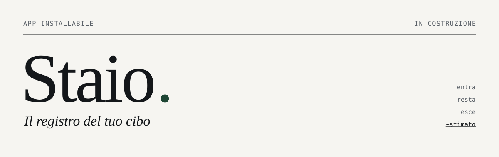
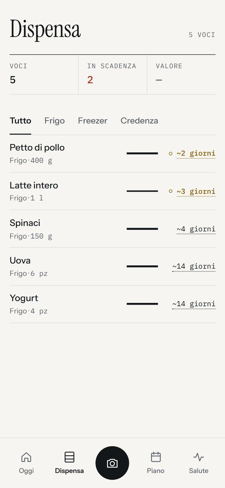
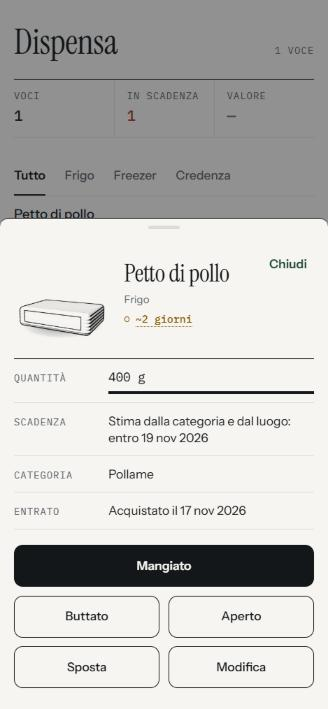
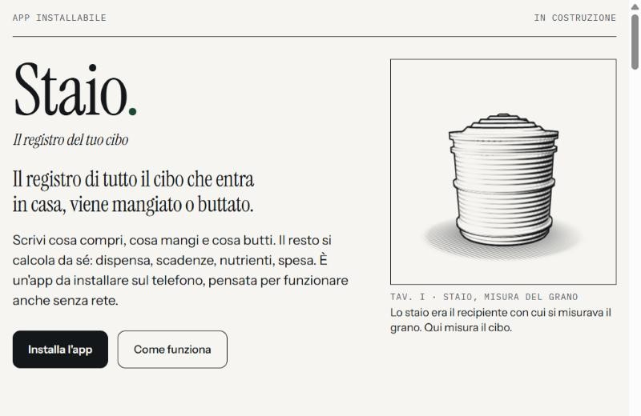
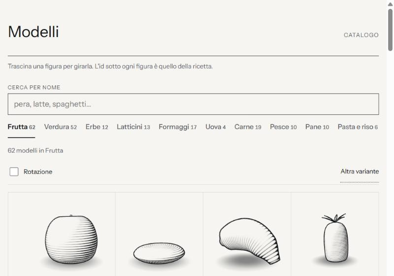

<picture>
  <source media="(prefers-color-scheme: dark)" srcset="docs/intestazione-scura.svg">
  
</picture>

Staio è un registro di tutto il cibo che entra in casa, viene mangiato o buttato. Scrivi cosa compri e cosa mangi; dispensa, scadenze, nutrienti e spesa si calcolano dal registro.

È una web app da installare sul telefono. I dati restano sul dispositivo e l'app funziona anche senza rete.

**[Apri Staio](https://staio-black.vercel.app)** · **[Apri l'app](https://staio-black.vercel.app/app)** · **[Catalogo dei modelli](https://staio-black.vercel.app/modelli)**

---

## Stato

Il progetto è in costruzione. Questa tabella dice cosa c'è davvero.

| Parte | Stato |
|---|---|
| Registro a eventi, dispensa calcolata | Fatto, con revisione indipendente |
| Scadenze: etichetta, dopo l'apertura, freezer, stime per categoria | Fatto, con revisione indipendente |
| Unità di misura e conversioni | Fatto |
| Archivio sul dispositivo, copia ed esportazione dei dati | Fatto |
| App: Oggi, Dispensa, aggiunta a mano e rapida, riallineamento | Prima versione |
| Diario: pasti, pasti abituali, acqua, peso, umore, integratori | Prima versione |
| Codice a barre con Open Food Facts | Scritto, da provare sui telefoni |
| Scontrino da foto, con la chiave AI dell'utente | Scritto, da provare con una chiave vera |
| Nutrienti e confronto con i riferimenti | Prima versione, con revisione indipendente |
| Uso senza rete | Scritto, da provare sui telefoni |
| Modelli 3D a incisione, 283 alimenti | Fatto, forme da rifinire |
| Piano settimanale, lista della spesa, meal prep | Prima versione, con revisione indipendente |
| Ricettario con importazione da indirizzo o testo | Prima versione, con revisione indipendente |
| Frigo e dispensa da foto, con la chiave AI dell'utente | Scritto, da provare con una chiave vera |
| Pasto da una frase o dalla foto del piatto, idee di ricette con ciò che c'è in casa | Scritto, da provare con una chiave vera |
| Controllo di allergeni ed esclusioni sulle ricette | Prima versione, con revisione indipendente |
| Analisi: dispendio stimato, proiezione del peso, orari, associazioni, esperimenti | Prima versione, con revisione indipendente |
| Qualità dei prodotti per dimensioni, alternative, modalità scaffale | Prima versione, con revisione indipendente |
| Assistente: domande a parole, viste da fissare in Oggi | Scritto, da provare con una chiave vera |
| Temi: Registro, Bottega, Ardesia, Netto | Fatto |
| Frigo, freezer e credenza in 3D dai dati della dispensa | Prima versione |
| Conferma dell'etichetta per gli ingredienti non verificabili | Prima versione |
| Avvisi senza server | Scritto, da provare sui telefoni |
| Ricette da video condivisi all'app | Scritto; il servizio di estrazione non è ancora attivo |
| Allergeni dei prodotti letti dal codice, con ingredienti e tracce di Open Food Facts | Prima versione, con revisione indipendente |
| Abbinamenti di gusto da FlavorGraph e dalle proprie ricette | Prima versione |
| Tè e caffè scalati dalla dispensa, pasto pianificato da spostare | Prima versione |
| Sincronizzazione con file e con Drive | Scritto; Drive in attesa delle credenziali |
| Tema Vivo a colori, modelli 3D a colori | In costruzione |

## Com'è

<p>
  
  &nbsp;
  
</p>

<p>
  
</p>

Carta e inchiostro, un solo colore d'accento, gerarchia fatta di filetti. Tre caratteri con ruoli netti: con grazie per titoli e cifre grandi, lineare per l'interfaccia, a larghezza fissa per i dati.

## Tre idee

### Un solo registro

Ogni fatto è un evento: comprato, aperto, mangiato, buttato, spostato in freezer. Gli eventi si aggiungono e non si modificano mai; una correzione è un nuovo evento. Dispensa, costi e spreco sono calcolati da lì, quindi non possono contraddirsi.

Unire i registri di due dispositivi dà lo stesso risultato in qualunque ordine. È la proprietà su cui si regge la sincronizzazione, ed è verificata con permutazioni casuali nei test.

### Il dato dice quanto è certo

| Come appare | Cosa significa |
|---|---|
| `92 g` | Pesato o letto dall'etichetta |
| `~6 mg` con sottolineatura a puntini | Stimato |
| `—` | Non tracciato |

Una scadenza stimata dalla categoria non si presenta come una data stampata. Un giorno senza dati non conta come digiuno.

### Ogni alimento ha la sua figura

<p>
  
</p>

I modelli 3D non sono file: sono ricette di pochi numeri che il telefono trasforma in geometria, anche senza rete. Dieci forme di base (solido di rotazione, scatola, sacchetto, forma allungata, foglia, grappolo, spicchio, cimette, fetta a mezzaluna, pesce) e i modelli composti coprono 283 alimenti. Il volume è reso a incisione: tratti a inchiostro che seguono la forma, più fitti dove c'è ombra.

Per un prodotto senza ricetta l'app sceglie una forma adatta alla confezione e alla quantità.

## Come è fatto

| Cartella | Contenuto |
|---|---|
| `src/core/ledger` | Registro a eventi, unione tra dispositivi, dispensa calcolata |
| `src/core/expiry` | Scadenze e tabella delle durate per categoria |
| `src/core/units` | Unità, conversioni, lettura di quantità scritte a parole |
| `src/core/diary`, `nutrition` | Diario, nutrienti e confronto con i riferimenti |
| `src/core/plan`, `prep`, `recipes`, `shopping` | Piano, preparazioni, ricettario, lista della spesa |
| `src/core/allergens` | Controllo di allergeni ed esclusioni, con esito incerto esplicito |
| `src/core/analysis` | Stime e associazioni con la loro incertezza, esperimenti |
| `src/core/quality` | Qualità dei prodotti per dimensioni, ogni soglia con la fonte |
| `src/core/views` | Viste dichiarative: l'AI sceglie cosa mostrare, i numeri li calcola l'app |
| `src/core/notify` | Avvisi: cosa notificare e quando, senza server |
| `src/core/sync` | Unione dei dati tra dispositivi, con file e con Drive |
| `src/core/taste` | Abbinamenti di gusto tra ingredienti |
| `worker/video` | Servizio che estrae il testo dai video condivisi |
| `src/data` | Archivio sul dispositivo (IndexedDB), copia e ripristino |
| `src/design` | Tema e componenti dell'interfaccia |
| `src/models3d` | Generatore dei modelli, materiale a incisione, catalogo |
| `src/features` | Logica e componenti delle schermate |
| `src/pwa` | Uso senza rete |
| `src/app` | Pagine: sito, app, catalogo |

`src/core` è logica pura: non dipende da React, dalla rete né dal disco, e ha i suoi test accanto.

Next.js 16, React 19, TypeScript, three.js, Dexie, Vitest. Stili con CSS Modules e variabili di tema.

## Avvio

```bash
pnpm install
pnpm dev
```

| Comando | Cosa fa |
|---|---|
| `pnpm test` | Test |
| `pnpm typecheck` | Controllo dei tipi |
| `pnpm lint` | Lint |
| `pnpm build` | Build |

## Strada

1. **Cattura, dispensa, scadenze.** Aggiunta a mano fatta; scontrino, codice a barre, foto e voce da fare.
2. **Diario.** Pasti, acqua, peso, umore, integratori.
3. **Nutrizione e qualità.** Macro e micronutrienti, indice di qualità personale, alternative migliori.
4. **Piani, meal prep, spesa.** Lista della spesa calcolata da piano, consumi e scorte.
5. **Ricettario.** Ricette personali, importazione da link e video, abbinamenti di gusto.
6. **Rete di dati condivisa.** Catalogo comune tra chi usa l'app.
7. **Analisi.** Fabbisogno reale, andamenti, esperimenti personali.

## Note

Staio non dà pareri medici: confronta ciò che mangi con valori di riferimento.

I valori nutrizionali degli alimenti generici vengono da USDA FoodData Central (pubblico dominio) e descrivono prodotti statunitensi: sono stime, e per pane, pasta e cereali i nutrienti alterati dall'arricchimento non sono riportati. I valori di riferimento sono quelli dell'EFSA per adulti. I dati dei prodotti confezionati vengono da Open Food Facts.

Le durate degli alimenti senza data in etichetta sono stime prudenti. Non sostituiscono l'etichetta né il giudizio di chi apre il frigo.

Gli abbinamenti di gusto derivano da FlavorGraph e FlavorDB, dati sotto CC BY-NC-SA 3.0: per questo l'app resta non commerciale.

Il controllo di allergeni ed esclusioni aiuta ma non sostituisce la lettura dell'etichetta: non rileva tracce né contaminazioni, e gli elenchi di alimenti e derivati non sono esaustivi. Ciò che non si può verificare è segnalato come incerto, mai come compatibile.

Le analisi mostrano andamenti e associazioni osservate con la loro incertezza: non dicono perché qualcosa accade. Le soglie "a semaforo" dell'indice di qualità vengono dallo schema volontario britannico per l'etichettatura frontale; ogni soglia usata ha la sua fonte in `src/core/quality/data/FONTI.md`.

## Licenza

Il codice è pubblico e si può usare, modificare e ridistribuire per scopi non commerciali, secondo la [PolyForm Noncommercial License 1.0.0](LICENSE.md). L'uso commerciale non è permesso. Alcuni dati inclusi hanno una licenza propria: l'elenco è in [NOTICE](NOTICE).
